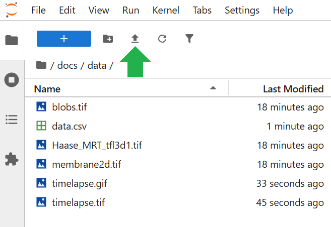

# How Generative AI impacts Image Data Science

This page contains materials for the GenAI Satellite Workshop at the [Helmholtz Imaging Conference 2026](https://events.hifis.net/event/2690/timetable/). After three introductory presentations, we will dive into using Large Language Models for code generation and data analysis. 

Slides will be made available e.g. via Zenodo and linked from here.

## Target audience

The exercises are written for scientists from all disciplines who work with imaging data and have basic understanding of Python programming.

## How to use these materials

Before the course please make sure to setup your Jupyter environment as explained [on this page](setup.md).

Within Jupyter, create a new notebook and copy/paste prompts or code-snippets over into your empty notebook. Modify prompts to see how outputs change. Start new notebooks whenever you start a new exercise. The AI-assistant will be confused otherwise.

For analysing data, you can download it from [this repository](https://doi.org/10.5281/zenodo.24033765) and then upload it to Jupyter using this button:

Note that this is the way to go in training scenarios. When working with real data, you would not upload it to Jupyter. Instead, you would enter the path to your data in the Jupyter notebooks. 

## Acknowledgements 

We acknowledge the [Helmholtz Blablador service](https://helmholtz.cloud/services/?serviceID=d7d5c597-a2f6-4bd1-b71e-4d6499d98570) hosted at the Helmholtz Center Jülich which we are primarily using for this training.

We acknowledge the financial support by the Federal Ministry of Education and Research of Germany and by Sächsische Staatsministerium für Wissenschaft, Kultur und Tourismus in the programme Center of Excellence for AI-research „Center for Scalable Data Analytics and Artificial Intelligence Dresden/Leipzig“, project identification number: ScaDS.AI